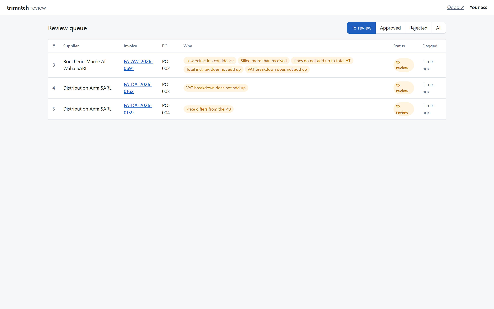
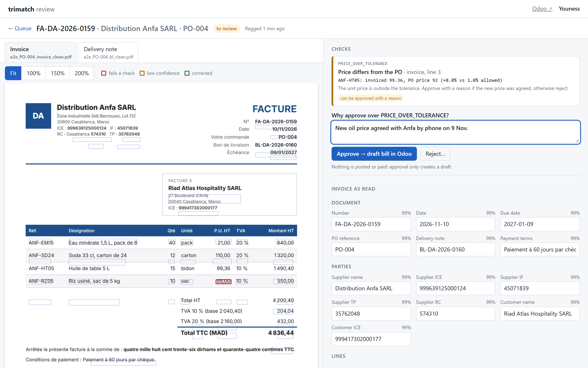
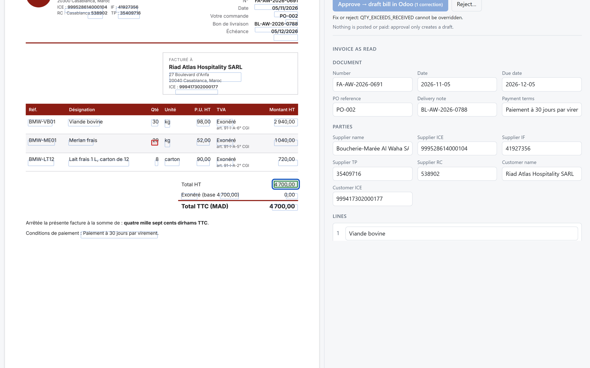

# trimatch

Reads Moroccan supplier paperwork (delivery notes and invoices: scans, photos, later UBL e-invoices), reconciles them against the purchase order and the goods receipt in Odoo (three-way match), and creates **draft** vendor bills. Uncertain cases go to a human review queue. Nothing is ever posted or paid automatically.

**Status:** Phase 0 vertical slice complete (Odoo 20 Community, Gemini extraction, deterministic three-way match). See [docs/SPEC.md](docs/SPEC.md) and [docs/progress.md](docs/progress.md).

## Quickstart

Needs Docker, [uv](https://docs.astral.sh/uv/) and a free Gemini API key from Google AI Studio. Only the generated synthetic documents are ever sent to Gemini. The commands work in PowerShell and bash, run from the repo root.

```
git clone https://github.com/TeCom0/trimatch.git
cd trimatch
cp .env.example .env            # then put your key after GEMINI_API_KEY=
```

**1. Odoo 20 with the fake company** (details in [odoo/README.md](odoo/README.md)):

```
docker compose -f odoo/docker-compose.yml up -d db
docker compose -f odoo/docker-compose.yml run --rm odoo odoo db init trimatch --country MA
docker compose -f odoo/docker-compose.yml run --rm odoo odoo -d trimatch -i purchase_stock,l10n_ma --stop-after-init
docker compose -f odoo/docker-compose.yml run --rm odoo bash -c "odoo shell -d trimatch --no-http < /mnt/trimatch/odoo/seed.py"
docker compose -f odoo/docker-compose.yml up -d odoo
```

The seed prints `ODOO_API_KEY=...` once: put that line in `.env`.

**2. Python side:**

```
uv sync --project backend
uv run --project backend playwright install chromium
uv run --project backend python -m trimatch.odoo_adapter --check
uv run --project backend trimatch db init
```

`db init` creates the review store (database `trimatch_review` in the same Postgres container) and writes its generated password to `.env`.

**3. Generate the 5 orders' delivery notes and invoices, then process them:**

```
uv run --project backend python -m trimatch.generate --split e2e
uv run --project backend trimatch process "data/synthetic/e2e/*" --extractor gemini
```

Expected: draft bills in Odoo for PO-001, PO-003 and PO-005 with the PDFs attached, and review cases in the review store for PO-002 (`QTY_EXCEEDS_RECEIVED`, short delivery) and PO-004 (`PRICE_OVER_TOLERANCE`, +8%). Running it again creates nothing new. Gemini sometimes misreads one number (seen: a VAT base of 2 204,00 read as 2 204,04 on PO-003); the VAT checks then send that invoice to review (`VAT_MATH`) instead of drafting it, which is the intended behaviour.

Measured 2026-11-15 on a fresh clone (Windows 11, Docker images already pulled): 4 min 31 s from `docker compose up` to the processed documents. Open http://127.0.0.1:8069 (admin / admin, local only) → Invoicing → Vendors → Bills.

**4. Review screen** (needs Node 24):

```
npm --prefix frontend ci
npm --prefix frontend run build
uv run --project backend trimatch serve
```

Open http://127.0.0.1:8000. Each flagged invoice shows the document with a box on every extracted value, the failed checks in words, and the values as read next to the PO's ordered/received quantities and prices. Fix a misread value and the checks re-run; **Approve** creates the draft bill in Odoo (with an internal note naming the reviewer, the corrections and the reason), **Reject** closes the case with a reason. A price difference or a delivery-note mismatch can be approved with a written reason; a bill for more than was received cannot. Corrections are stored as labelled data. Set `TRIMATCH_REVIEWER=<your name>` in `.env` first. For UI development run `npm --prefix frontend run dev` (port 5173, API proxied to 8000).


*The queue after a Gemini run on the 5 e2e orders: two invoices became drafts, three are waiting.*


*PO-004: the oil price is 8% over the PO. The check explains itself; approving needs a written reason, which also goes into the note on the Odoo draft.*


*PO-002: the reviewer corrected a misread total (4 700,05 → 4 700,00); the arithmetic checks now pass, but the invoice bills 20 kg of merlan when 14 kg were received, which can't be overridden.*

**Known limitation (measured 2026-11-16, debug run, not a reported result):** the boxes are the ones Gemini returns, and they are often off. On the 10 clean e2e PDFs, Gemini's box centre fell inside the true box for 127 of 388 fields (median vertical offset about 1% of the page, sometimes a whole table row; visible above on PO-004, where the red box is on the line below 99,36). The values are right; the highlight can point at the neighbouring number. Fixing this (snapping boxes to the PDF text layer, OCR words for scans) is a follow-up.

`--extractor labels` uses the generator's ground truth instead of Gemini (no API key needed), `--dry-run` decides without writing anything, `--review-to json` writes review cases as files in `data/review/` instead of the store, and `python -m eval.run --split test` reproduces the results below.

## Results

First measured result, 2026-11-15: extraction with Gemini 3.5 Flash Lite (free tier) on the **held-out synthetic test set** (seed 2, 200 documents: 100 delivery notes + 100 invoices, each 40 clean and 160 degraded by rotation, blur, a stamp or handwriting). Code `7b4bdbc`, prompt `cadd85983cea`. Full report: [eval/results/2026-11-15_7b4bdbc_test_gemini-3.5-flash-lite.md](eval/results/2026-11-15_7b4bdbc_test_gemini-3.5-flash-lite.md).

| | Field accuracy | Document accuracy (every field right) |
|---|---|---|
| All 200 documents | 99.2% (7460/7520) | 86.5% (173/200) |
| Clean (40) | 99.9% | 97.5% |
| Rotated (40) | 98.1% | 85.0% |
| Blurred (40) | 99.6% | 90.0% |
| Stamped (40) | 98.8% | 77.5% |
| Handwritten quantities / notes (40) | 99.5% | 82.5% |

End to end against Odoo ([e2e report](eval/results/2026-11-15_7b4bdbc_e2e_gemini-3.5-flash-lite.md), the 5 seeded POs, clean and degraded sets, dry run): 8 of 10 decisions exactly as expected, **no wrong draft**. The 2 misses are clean cases sent to review because a misread number broke the VAT/total checks, which is the safe direction.

Caveats: synthetic documents from one layout, so these numbers say nothing yet about real supplier paperwork; that needs the Phase 1 real held-out set. LLM output varies between runs even at temperature 0.

## Data

All documents in this repo are synthetic. Company names and ICE numbers are fictitious. `data/` is gitignored.
